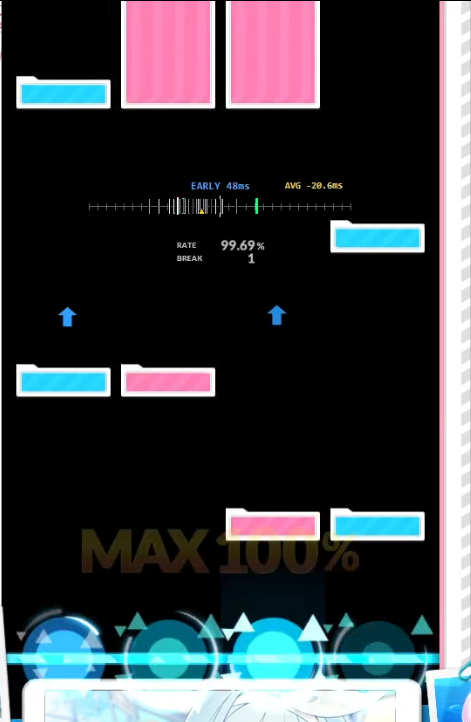

# 🎯 SepanViewer Native (C++ Standalone)

<p align="center">
  
  
  
  
  
</p>

<p align="center">
  <b>DJMAX RESPECT V 전용 초경량 독립형 실시간 세부판정 인디케이터 (Hit Error Bar)</b><br>
  OBS나 웹 브라우저, 무거운 파이썬 가상환경 없이 <b>단일 C++ 실행 파일(.exe)</b>만으로 게임 화면 위에 직접 판정 눈금자를 띄웁니다.
</p>
  <p align="center">
  
  </p>

---

## 💡 프로젝트 소개 (About)

본 프로젝트는 **[Sobrem 님의 예시 영상](https://www.youtube.com/watch?v=be2ie5e_9og)**으로 알려진 [DJMAX RESPECT V](https://store.steampowered.com/app/960170/DJMAX_RESPECT_V) 세부판정 뷰어(SepanViewer)의 아이디어에서 출발하였습니다.

기존의 **Python + OBS Studio 브라우저 소스** 방식은 방송 송출 화면을 통해서만 확인할 수 있어 플레이어가 게임 플레이 도중 실시간으로 타점을 확인하기 어렵다는 한계가 있었습니다. 이를 해결하기 위해 **Google AI와의 협업을 통해 완전히 독립적인 C++ 네이티브 프로그램으로 전환**하였으며, 화면 캡처 파이프라인을 **Windows 네이티브 DXGI Desktop Duplication API**로 재설계하여 최상의 반응성과 정밀도를 달성했습니다.

---

## ⚡ 기술적 특징 (Technical Highlights)

* **🚀 Windows DXGI Desktop Duplication (DirectX 11) 네이티브 캡처**
  * DWM(데스크톱 창 관리자) 합성 지연을 우회하고 **GPU VRAM에서 기어 영역을 직접 초고속 복사**.
  * `DXGI_OUTDUPL_FRAME_INFO.LastPresentTime`을 활용하여 **"GPU가 실제로 프레임을 화면에 출력한 절대 시각"**을 1ms 미만의 오차로 획득, 캡처 파이프라인 지연을 근본적으로 상쇄.
* **📉 극적인 시스템 자원 절감**
  * 파이썬 런타임 및 멀티프로세싱 오버헤드를 완전히 제거하여 **메모리(RAM) 사용량을 약 18MB 수준으로 압축**.
* **📏 BMS 스타일 가로형 히트 에러 바**
  * 기어 옆에 세로로 뜨던 기존 방식 대신, 노트가 떨어지는 **판정선 바로 위/아래에 가로형 슬림 인디케이터**를 배치하여 시선 이동 없이 즉각적인 타이밍 조절 가능.
* **🟡 실시간 평균 타점 화살표 (▲) & AVG 수치 표기**
  * 최근 타격 오차의 이동 평균을 실시간 계산하여 눈금자 아래 **황금색 삼각형(▲)**과 **`AVG -3.5ms`** 텍스트로 표시.
  * 내가 평균적으로 서둘러서 치는지(Fast/Early), 늦게 치는지(Slow/Late) 한눈에 직관적으로 파악.
* **🎨 단계별 잔상 페이드아웃 (Fade-out)**
  * 눈금자에 남는 마커가 오래될수록 **순백색(100%) → 연회색 → 어두운 회색(20%)**으로 서서히 어두워지며 자연스럽게 소멸.
* **🖱️ Ctrl + 마우스 드래그로 자유로운 위치 이동**
  * 평소에는 게임 클릭을 방해하지 않는 완전 클릭 관통(`WS_EX_TRANSPARENT`) 상태 유지.
  * **`Ctrl` 키를 누른 채 마우스로 드래그**하면 원하는 위치로 즉시 이동되며, 마우스를 놓으면 `config.ini`에 **좌표 자동 영구 저장**.
* **⌨️ 실시간 모드 전환**
  * 프로그램을 껐다 켤 필요 없이, **`4`**, **`5`**, **`6`**을 입력하면 4B / 5B / 6B 키 모드가 즉각 전환 (설정 파일 자동 반영).
* **🛡️ 100% 안티치트 안전 (Passive Capture)**
  * 게임 프로세스 메모리를 건드리지 않는 외부 캡처 방식(XIGNCODE / EAC 밴 위험 0%).
  * Windows `WDA_EXCLUDEFROMCAPTURE` 기술을 적용하여, **오버레이 눈금자가 게임 화면을 캡처할 때는 투명인간처럼 제외**되므로 눈금자 뒤의 노트를 절대 가리지 않음.

---

## 🎮 필수 게임 설정 (In-Game Settings)

정확한 노트 템플릿 매칭 및 캡처를 위해 게임 내 옵션을 반드시 아래와 같이 맞춰주세요.

| 옵션 항목 | 권장 설정값 | 이유 |
|---|---|---|
| **화면 모드** | **전체 창 모드** (Borderless) | 전체화면 시 오버레이가 가려지는 현상 방지 |
| **기어 위치** | **센터 기어 (Center)** | 중앙 캡처 ROI 영역(x: 720~1200) 고정 |
| **레인 불투명도** | **100%** | BGA 영상 비침으로 인한 템플릿 인식 실패 방지 |
| **노트 스킨** | **Blue Archive** | 템플릿 매칭에 사용되는 사각형 규격 스킨 |
| **트리거/사이드** | **기본 색상** | HSV 색상 인식 범위 표준 |

---

## 🛠️ 조작 및 단축키 (Controls)

* **실시간 모드 변경**: 아무 화면에서 `4`, `5`, `6` 입력
* **오버레이 위치 이동**: **`Ctrl` 키를 누른 상태**에서 오버레이 눈금자를 마우스 왼쪽 버튼으로 잡고 드래그 (놓으면 `config.ini`에 자동 저장)
* **인식 검증 사진 저장 (스냅샷)**: 디맥 중에 **`F8`** 입력

---

## ⚙️ 설정 파일 (`config.ini`)

실행 파일(`.exe`)과 같은 경로에 있는 `config.ini`를 메모장으로 열어 컴파일 없이 언제든지 세부 수치를 조절할 수 있습니다.

```ini
[general]
fps=60
globalOffset=-30
; Ordinary match window. A unique, well-observed past note may use bounded late recovery.
maxWindow=150
mode=4
; Template set: cap{mode}_{blue|white}_{note}.png. Restart after changing.
; Use note=default for legacy unsuffixed cap{mode}_{color}.png files.
note=bluearchive
; All Y values below are pixels local to the captured ROI, increasing downward.
judgeY=750
noteThreshold=0.75
; Last corrected note-anchor Y to detect (not a timing offset).
maxDetectY=690
; Keep detections at least this far above judgeY to avoid judgment effects.
detectionMarginY=60
; Add to raw template-top Y. Positive moves the note down; 0 preserves old normal reference.
normalNoteAnchorY=0
; Add to side edge Y. -10 preserves the previous side-note reference.
sideNoteAnchorY=-10
; Avoid MAX judgment text/effects around Y=600 for wide side blocks.
sideMaxDetectY=580
maxMarkers=30
avgSamples=60
triggerColor=default
sideColor=default
showAVG=true
showEarlyLate=true
; Analysis panel + per-input observation CSVs. Restart after changing.
; true: per-key debug panel + detailed ruler labels/logs; false: centered EARLY/LATE only.
debugmode=false
; Legacy fallback when debugmode is absent. Explicit debugmode always wins.
showLaneDebug=true
; Fixed thick lane arrows: EARLY up / LATE down, 500ms fade. Independent of debugmode.
laneArrows=true
; Show arrows only when absolute timing error strictly exceeds this many milliseconds.
; 0: all nonzero errors; example 41.666: only errors beyond +/-41.666ms.
laneArrowThresholdMs=41.666
; Arrow center Y in the game client at reference 1920x1080 (not ruler/OBS coordinates).
laneArrowY=450
; Separate panel, outside the default gear capture (X=720..1199).
laneDebugX=1301
laneDebugY=0
perfectRangeColor=0,255,120
; Game-window-only capture excludes this overlay even when it covers the gear.
; OBS: capture Sepan Overlay separately as a Window Capture source.
overlayX=809
overlayY=199

[4LANE]
1=s
2=d
3=l
4=;
L=Space
R=RAlt
A=LShift
B=RShift

[5LANE]
1=a
2=s
3a=d
3b=l
4=;
5='
L=Space
R=RAlt
A=LShift
B=RShift

[6LANE]
1=a
2=s
3=d
4=l
5=;
6='
L=Space
R=RAlt
A=LShift
B=RShift

```

---
* 100% 의 정확한 판정을 보장하지 않습니다. 보조적인 참고용으로만 사용하시기 바랍니다.
* 사용하는 노트에 따라 롱노트, 사이드, 트리거 키의 정확도가 조금 떨어질 수 있습니다.
