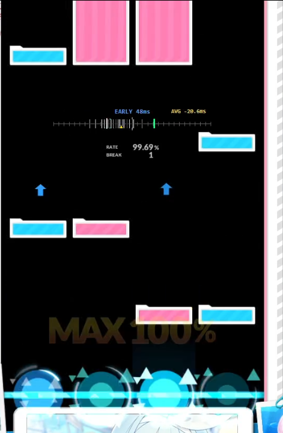

# 🎯 SepanViewer Native (C++ Standalone)

<p align="center">
  
  
  
  
  
</p>

<p align="center">
  <b>DJMAX RESPECT V 전용 초경량 독립형 실시간 세부판정 인디케이터 (Hit Error Bar)</b><br>
  OBS나 웹 브라우저, 무거운 파이썬 가상환경 없이 <b>단일 C++ 실행 파일(.exe)</b>만으로 게임 화면 위에 직접 판정 눈금자를 띄웁니다.
</p>
<p align="center">
  
</p>

---

## 💡 프로젝트 소개 (About)

본 프로젝트는 **[Sobrem 님의 예시 영상](https://www.youtube.com/watch?v=be2ie5e_9og)**으로 알려진 [DJMAX RESPECT V](https://store.steampowered.com/app/960170/DJMAX_RESPECT_V) 세부판정 뷰어(SepanViewer)의 아이디어에서 출발하였습니다.

기존의 **Python + OBS Studio 브라우저 소스** 방식은 방송 송출 화면을 통해서만 확인할 수 있어 플레이어가 게임 플레이 도중 실시간으로 타점을 확인하기 어렵다는 한계가 있었습니다. 이를 해결하기 위해 독립적인 C++ 네이티브 프로그램으로 전환하였습니다.

캡처 파이프라인은 버전에 따라 다음과 같이 발전해 왔습니다. **v1.1.1까지는 DXGI Desktop Duplication** 을 사용했고, **v1.1.2부터는 Windows Graphics Capture(WGC) 기반의 '게임 창 전용' 캡처** 로 전환했습니다. 그리고 **v1.1.3부터는 [Anchovia 님의 beatscope](https://github.com/Anchovia/beatscope)** 가 제공하는 DJMAX charts 데이터를 참고하여, 플레이 입력으로 곡을 식별하고 차트 데이터로 판정을 진행합니다.

---

## 📜 버전 히스토리 (Version History)

| 버전 | 변경 사항 |
|---|---|
| **~ v1.1.1** | **DXGI Desktop Duplication(DirectX 11)** 기반 화면 캡처 |
| **v1.1.2** | **Windows Graphics Capture(WGC)** 기반 **게임 창 전용 캡처**로 전환. 게임 창(HWND)만 캡처하고 기어 ROI만 복사하여, 오버레이·데스크톱이 인식에 섞이지 않습니다. 단, WGC 특성상 **Windows 11 미만에서는 캡처 시 노란 테두리(yellow border)** 가 표시됩니다([제거 방법](#-windows-11-미만-노란-테두리) 참고). |
| **v1.1.3** | **[beatscope](https://github.com/Anchovia/beatscope) charts 데이터 기반 판정** 추가. 플레이 중 입력으로 곡을 식별하면 이미지 판정을 멈추고, 오프셋만 보정해 charts 데이터로 판정합니다. 관련 `config.ini` 항목과 `F1` 단축키가 추가되었습니다. |

---

## ⚡ 기술적 특징 (Technical Highlights)

* **🪟 Windows Graphics Capture (v1.1.2~) — 게임 창 전용 캡처**
  * `DJMAX RESPECT V` 창의 HWND만 캡처하고, 그중 **기어 ROI(480x900)만 CPU로 복사**합니다. 오버레이·눈금자·다른 데스크톱 창은 인식에 포함되지 않습니다.
  * 캡처 프레임의 **컴포지터 시각(WGC `SystemRelativeTime`, QPC 기반)** 을 사용하여 캡처 파이프라인 지연을 상쇄합니다.
  * *(v1.1.1까지는 DXGI Desktop Duplication 방식으로 전체 화면을 복사했습니다.)*
* **📉 극적인 시스템 자원 절감**
  * 파이썬 런타임 및 멀티프로세싱 오버헤드를 완전히 제거하여 **메모리(RAM) 사용량을 약 18MB 수준으로 압축**. (charts 데이터 판정 사용 시 차트 팩을 메모리에 올리므로 사용량이 늘어납니다.)
* **📏 BMS 스타일 가로형 히트 에러 바**
  * 기어 옆에 세로로 뜨던 기존 방식 대신, 노트가 떨어지는 **판정선 바로 위/아래에 가로형 슬림 인디케이터**를 배치하여 시선 이동 없이 즉각적인 타이밍 조절 가능.
* **🟡 실시간 평균 타점 화살표 (▲) & AVG 수치 표기**
  * 최근 타격 오차의 이동 평균을 실시간 계산하여 눈금자 아래 **황금색 삼각형(▲)**과 **`AVG -3.5ms`** 텍스트로 표시.
  * 내가 평균적으로 서둘러서 치는지(Fast/Early), 늦게 치는지(Slow/Late) 한눈에 직관적으로 파악.
* **🎨 단계별 잔상 페이드아웃 (Fade-out)**
  * 눈금자에 남는 마커가 오래될수록 **순백색(100%) → 연회색 → 어두운 회색(20%)**으로 서서히 어두워지며 자연스럽게 소멸.
* **🖱️ Ctrl + 마우스 드래그로 자유로운 위치 이동**
  * 평소에는 게임 클릭을 방해하지 않는 완전 클릭 관통(`WS_EX_TRANSPARENT`) 상태 유지.
  * **`Ctrl` 키를 누른 채 마우스로 드래그**하면 원하는 위치로 즉시 이동되며, 마우스를 놓으면 `config.ini`에 **좌표 자동 영구 저장**.
* **⌨️ 실시간 모드 전환**
  * 프로그램을 껐다 켤 필요 없이, **`4`**, **`5`**, **`6`**을 입력하면 4B / 5B / 6B 키 모드가 즉각 전환 (설정 파일 자동 반영).
* **🛡️ 100% 안티치트 안전 (Passive Capture)**
  * 게임 프로세스 메모리를 건드리지 않는 외부 캡처 방식(XIGNCODE / EAC 밴 위험 0%).
  * Windows `WDA_EXCLUDEFROMCAPTURE` 기술을 적용하여, **오버레이 눈금자가 게임 화면을 캡처할 때는 투명인간처럼 제외**되므로 눈금자 뒤의 노트를 절대 가리지 않음.

---

## 🧭 Charts 데이터 기반 판정 (v1.1.3~)

[Anchovia 님의 beatscope](https://github.com/Anchovia/beatscope) 가 제공하는 DJMAX RESPECT V charts 데이터(JSON 팩)를 참고하여, 이미지 인식에만 의존하지 않고 **차트의 절대 시각**을 판정 기준으로 사용합니다.

* **동작 흐름**
  1. **식별 단계**: 플레이 중 입력하는 버튼을 각 곡의 노트 패턴과 대조해 후보를 좁혀 나갑니다. 이 단계에서는 기존 이미지 템플릿 매칭 판정이 그대로 동작합니다.
  2. **확정**: 하나의 곡(난이도 포함)으로 확정되면 **이미지 판정을 중단**합니다.
  3. **판정 단계**: 타이밍 오프셋만 보정한 뒤, charts 데이터의 노트 시각(`due = 노트 시각 + 오프셋`)으로 판정을 이어갑니다. 오프셋은 매칭된 입력들의 이동 중앙값으로 계속 갱신되어 서서히 변하는 드리프트를 흡수합니다.

* **정확도가 아니라 '분포'가 안정됩니다**
  * 이미지 템플릿 매칭은 프레임마다 기준점이 흔들려 오차가 들쭉날쭉했습니다. 차트의 **절대 시각**을 기준으로 삼으면 **매번 같은 기준으로 측정**되므로, 정확도 자체가 크게 오르기보다는 **오차의 분포가 일정해지고 재현성(편차의 안정성)이 높아집니다.**

* **모드/레인 규칙**
  * `mode=6` 설정은 6B와 8B가 키 세팅/이미지 셋을 공유하므로 **6B와 8B charts를 함께** 봅니다.
  * charts의 `SL`/`SR` 는 config의 `A`/`B` 키, `TL`/`TR` 는 config의 `L`/`R` 키에 대응됩니다.

* **한계**
  * 곡 시작 부근에서 시작한다고 가정합니다(첫 입력을 곡 앞부분 노트에 앵커). 중간부터 시작하면 식별이 안 될 수 있으며, 이 경우 조용히 기존 이미지 판정이 유지됩니다.
  * 같은 곡의 다른 난이도가 초반에 유사하면 확정이 늦어질 수 있습니다. 홀드 노트는 머리(시작)만 판정합니다.
  * charts가 없으면(경로 미설정) 자동으로 이미지 판정만 사용합니다.

---

## 🪟 Windows 11 미만 노란 테두리

v1.1.2부터 사용하는 **Windows Graphics Capture** 는 Windows 11 미만에서 캡처 대상 창에 **노란 테두리(yellow border)** 를 그립니다. 이 테두리는 캡처는 정상이지만 시각적으로 거슬릴 수 있으며, 아래 프로젝트의 방법으로 제거할 수 있습니다.

* 참고: **[V-Conet / dwm-no-border](https://github.com/V-Conet/dwm-no-border)** — DWM(데스크톱 창 관리자) 단계에서 캡처 테두리를 없애는 기술. (해당 저장소의 안내를 참고하세요.)

---

## 🎮 필수 게임 설정 (In-Game Settings)

정확한 노트 템플릿 매칭 및 캡처를 위해 게임 내 옵션을 반드시 아래와 같이 맞춰주세요.

| 옵션 항목 | 권장 설정값 | 이유 |
|---|---|---|
| **화면 모드** | **전체 창 모드** (Borderless) | 전체화면 시 오버레이가 가려지는 현상 방지 |
| **기어 위치** | **센터 기어 (Center)** | 중앙 캡처 ROI 영역(x: 720~1200) 고정 |
| **레인 불투명도** | **100%** | BGA 영상 비침으로 인한 템플릿 인식 실패 방지 |
| **노트 스킨** | **Blue Archive** | 템플릿 매칭에 사용되는 사각형 규격 스킨 |
| **트리거/사이드** | **기본 색상** | HSV 색상 인식 범위 표준 |

---

## 🛠️ 조작 및 단축키 (Controls)

* **실시간 모드 변경**: 아무 화면에서 `4`, `5`, `6` 입력 (4B / 5B / 6B 즉시 전환, `config.ini` 자동 저장)
* **오버레이 위치 이동**: **`Ctrl` 키를 누른 상태**에서 오버레이 눈금자를 마우스 왼쪽 버튼으로 잡고 드래그 (놓으면 `config.ini`에 자동 저장)
* **인식 검증 사진 저장 (스냅샷)**: 디맥 중에 **`Caps Lock`** 입력 → 같은 프레임의 원본/인식 이미지 PNG 두 장 저장 (`snapshots` 폴더)
* **차트 재식별**: **`F1`** 입력 → 현재 곡 식별/확정을 초기화하고 다시 추정 (charts 판정 사용 시)

---

## ⚙️ 설정 파일 (`config.ini`)

실행 파일(`.exe`)과 같은 경로에 있는 `config.ini`를 메모장으로 열어 컴파일 없이 언제든지 세부 수치를 조절할 수 있습니다.

```ini
[general]
fps=60
globalOffset=-30
; Ordinary match window. A unique, well-observed past note may use bounded late recovery.
maxWindow=150
mode=6
; Template set: cap{mode}_{blue|white}_{note}.png. Restart after changing.
; Use note=default for legacy unsuffixed cap{mode}_{color}.png files.
note=bluearchive
; All Y values below are pixels local to the captured ROI, increasing downward.
judgeY=750
noteThreshold=0.75
; Last corrected note-anchor Y to detect (not a timing offset).
maxDetectY=690
; Keep detections at least this far above judgeY to avoid judgment effects.
detectionMarginY=60
; Add to raw template-top Y. Positive moves the note down; 0 preserves old normal reference.
normalNoteAnchorY=0
; Add to side edge Y. -10 preserves the previous side-note reference.
sideNoteAnchorY=-10
; Avoid MAX judgment text/effects around Y=600 for wide side blocks.
sideMaxDetectY=580
maxMarkers=30
avgSamples=60
triggerColor=default
sideColor=default
showAVG=true
showEarlyLate=true
; Analysis panel + per-input observation CSVs. Restart after changing.
; true: per-key debug panel + detailed ruler labels/logs; false: centered EARLY/LATE only.
debugmode=false
; Legacy fallback when debugmode is absent. Explicit debugmode always wins.
showLaneDebug=true
; Fixed thick lane arrows: EARLY up / LATE down, 500ms fade. Independent of debugmode.
laneArrows=true
; Show arrows only when absolute timing error strictly exceeds this many milliseconds.
; 0: all nonzero errors; example 41.666: only errors beyond +/-41.666ms.
laneArrowThresholdMs=41.666
; Arrow center Y in the game client at reference 1920x1080 (not ruler/OBS coordinates).
laneArrowY=450
; Separate panel, outside the default gear capture (X=720..1199).
laneDebugX=1301
laneDebugY=0
perfectRangeColor=0,255,120
; Game-window-only capture excludes this overlay even when it covers the gear.
; OBS: capture Sepan Overlay separately as a Window Capture source.
overlayX=809
overlayY=199

; ---- Chart-data-assisted judgment (see Chart.hpp) ----
; true: identify the song from live key presses, then stop image judgment and
; judge from the JSON note times plus a measured, drifting timing offset.
chartEnabled=true
; Folder holding djmax-respect-v-{4,5,6,8}b.json chart packs. Mode 6 also reads
; the 8B pack because 6B and 8B share the key setting.
chartDir=C:\Users\1234\Desktop\beatscope\extract\assets\charts
; Anchor the first press against this many leading notes of each candidate.
; Raise it if the play does not begin near the start of the song.
chartStartWindowNotes=128
; true: allow the first press to anchor anywhere in the song (slower, larger).
chartFullScan=false
; Press-to-note timing tolerance used only while identifying the song.
chartToleranceMs=40
; Confirm after at least this many matched presses.
chartMinEvidence=16
; Confirm only when this fraction of presses matched.
chartConfirmRatio=0.8
; Score margin treated as a tie (keeps same-song difficulties unconfirmed).
chartPruneMargin=1
; Penalty per un-pressed chart note beyond chartMissAllowance, used to separate
; the same song's difficulties in both directions. 0 disables it.
chartDensityPenalty=1.0
; Fraction of matched presses allowed to be un-pressed chart notes without penalty.
chartMissAllowance=0.25
; Press-to-note window once a chart is confirmed.
chartWindowMs=120
; Offset samples kept for the running median (drift tracking).
chartOffsetSamples=16
; Re-arm identification this long after the confirmed chart's last note.
chartAutoResetGapMs=4000

[4LANE]
1=s
2=d
3=l
4=;
L=Space
R=RAlt
A=LShift
B=RShift

[5LANE]
1=a
2=s
3a=d
3b=l
4=;
5='
L=Space
R=RAlt
A=LShift
B=RShift

[6LANE]
1=a
2=s
3=d
4=l
5=;
6='
L=Space
R=RAlt
A=LShift
B=RShift
```

---

## 🙏 크레딧 (Credits)

* **Sobrem** — 원본 **SepanViewer** 세부판정 뷰어 아이디어 ([예시 영상](https://www.youtube.com/watch?v=be2ie5e_9og))
* **Anchovia** — **[beatscope](https://github.com/Anchovia/beatscope)**, DJMAX charts 데이터 제공 (v1.1.3~ 차트 판정에 사용)
* **V-Conet** — **[dwm-no-border](https://github.com/V-Conet/dwm-no-border)**, Windows 11 미만 WGC 캡처 테두리 제거 기술
* **OpenCV / 이미지 코덱** 라이선스 안내는 배포본의 `licenses` 폴더 참고

---
* 100% 의 정확한 판정을 보장하지 않습니다. 보조적인 참고용으로만 사용하시기 바랍니다.
* 사용하는 노트에 따라 롱노트, 사이드, 트리거 키의 정확도가 조금 떨어질 수 있습니다.
